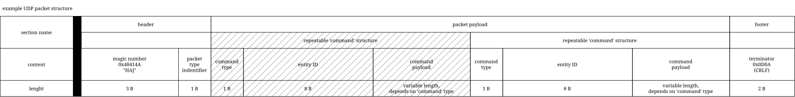

# R-Type network protocol

This document describes the wire protocol used by an R-Type client and server.
It is language-agnostic and describes the format currently implemented by the
project.

This document describes the network protocol of the part 1 of the project.

The protocol has two phases:

1. A reliable TCP handshake establishes the client's gameplay endpoint and
   assigns a player ID.
2. Gameplay data is exchanged as UDP datagrams. Clients send input; the server
   sends authoritative scene snapshots.

The protocol is binary. Multi-byte values are encoded in the host's current
little-endian representation. Implementations must serialize each field
explicitly; the in-memory layout or alignment of a language-specific
structure is not part of the protocol.

## Transport endpoints

| Transport | Port | Use |
| --- | ---: | --- |
| TCP | `7000` | Connection handshake and connection liveness |
| UDP | `7001` | Server gameplay endpoint |

The client binds its UDP socket to an available local port before opening the
TCP connection. The client advertises that local UDP port in the TCP hello.
The server uses the TCP peer address together with the advertised UDP port as
the client's UDP endpoint.

The server identifies UDP input by its source endpoint. A datagram from an
endpoint that was not registered by the TCP handshake is ignored.

## Common values

### Magic

Every protocol message begins with the three ASCII bytes:

```text
H A J
```

### Terminator

UDP packets end with the two bytes:

```text
0D 0A
```

This is a carriage return followed by a line feed. The terminator is part of
the packet framing and is not part of a command payload.

### Packet header

Every UDP packet starts with a four-byte header:

| Offset | Size | Field |
| ---: | ---: | --- |
| 0 | 3 bytes | Magic: `H`, `A`, `J` |
| 3 | 1 byte | Packet type |

### Command header

Commands inside UDP packets use a nine-byte header:

| Offset within command | Size | Field |
| ---: | ---: | --- |
| 0 | 1 byte | Command type |
| 1 | 8 bytes | Entity ID |

The entity ID field is present for every command, including commands that do
not refer to an entity. For such commands, its value is zero and must be
ignored.

A UDP packet has this general form:

```text
packet header
command header
command payload
...
terminator
```

Snapshot packets may contain multiple commands. The receiver reads commands
until it reaches the packet terminator.

## Connection handshake

The handshake uses TCP and does not use the UDP command layout.

### Client hello

The client sends exactly seven bytes after establishing the TCP connection:

| Offset | Size | Field |
| ---: | ---: | --- |
| 0 | 3 bytes | Magic: `H`, `A`, `J` |
| 3 | 1 byte | Packet type: `1` (`HELLO`) |
| 4 | 2 bytes | Client UDP port, unsigned 16-bit integer |
| 6 | 1 byte | `0D` |

The port is encoded little-endian. A port value of zero is invalid.

The server accepts the client only if the message is exactly seven bytes,
contains the expected magic and packet type, ends in `0D`, and contains a
non-zero UDP port.

### Server welcome

The server replies with exactly five bytes:

| Offset | Size | Field |
| ---: | ---: | --- |
| 0 | 3 bytes | Magic: `H`, `A`, `J` |
| 3 | 1 byte | Welcome type: `3` (`WELCOME`) |
| 4 | 1 byte | Assigned player ID |

The player ID must be in the range `0` through `3`. The welcome message has
no UDP terminator.

After sending the welcome, the server associates the TCP peer address and the
advertised UDP port with the assigned player ID.

## Lobby phase

After the handshake, the client and server exchange lobby messages on the same
TCP connection before gameplay starts. Lobby frames use a six-byte header:

| Offset | Size | Field |
| ---: | ---: | --- |
| 0 | 3 bytes | Magic: `H`, `A`, `J` |
| 3 | 1 byte | Lobby command |
| 4 | 2 bytes | Payload length, unsigned 16-bit big-endian |
| 6 | Variable | Payload |

Lobby multi-byte integers are big-endian. Player and master names use the same
eight-byte encoding as the control-plane `server_name`: 1–8 printable ASCII
bytes, zero-padded. Room names are `short_string` values: a one-byte length
followed by printable ASCII bytes.

The implemented commands are `JOIN` (`30`), `ROOM_LIST` (`31`), `CREATE_ROOM`
(`32`), `SELECT_ROOM` (`33`), `ROOM_JOINED` (`34`), `ROOM_STATE` (`35`),
`ROOM_REJECTED` (`36`), `LAUNCH_GAME` (`37`), `GAME_STARTED` (`38`),
`LEAVE_ROOM` (`39`), `ROOM_LEFT` (`40`), `ROOM_LIST_REQUEST` (`41`),
`CHAT_SEND` (`42`), and `CHAT_MESSAGE` (`43`).
Their payload layouts are documented in
[`server_system.md`](server_system.md#lobby-protocol).

A room holds at most four players. The first player to create or join a room is
its master; only the master may send `LAUNCH_GAME`. The server answers with
`GAME_STARTED` to every room member. Until then, the client shows the room and
waits for the master.

## Packet and command types

### Packet types

| Value | Name | Transport | Direction | Meaning |
| ---: | --- | --- | --- | --- |
| `1` | `HELLO` | TCP | Client to server | Client handshake |
| `2` | `INPUT` | UDP | Client to server | Latest player input state |
| `3` | `SNAPSHOT` | UDP | Server to client | Authoritative scene state |

The TCP welcome uses command value `3` in its fourth byte, but is a dedicated
five-byte TCP message rather than a UDP packet.

### Command types

| Value | Name | Meaning |
| ---: | --- | --- |
| `1` | `HELLO` | Defined for the generic packet format |
| `2` | `INPUT` | Player input payload |
| `3` | `WELCOME` | Player assignment |
| `4` | `SNAPSHOT_ENTITY` | One entity in a scene snapshot |

The `HELLO` and `WELCOME` command forms used by the TCP handshake are
specialized fixed-size messages described above.

here is a diagram of the packet structure:


## Input packet

An input packet has packet type `2` and contains exactly one input command.
Its layout is:

```text
4 bytes  packet header
1 byte   command type: 2
8 bytes  entity ID: zero
1 byte   input flags
2 bytes  terminator: 0D 0A
```

The complete packet is 16 bytes.

The input flags byte uses one bit per action:

| Bit | Action |
| ---: | --- |
| 0 | Up |
| 1 | Down |
| 2 | Left |
| 3 | Right |
| 4 | Fire |
| 5-7 | Unused |

An action is active when its bit is set to `1`. The server replaces the
player's current input state with the most recently received valid input
packet.

## Snapshot packet

A snapshot packet has packet type `3` and contains zero or more
`SNAPSHOT_ENTITY` commands. The server sends the latest authoritative scene
to each connected client.

Each entity command has the common nine-byte command header, a 32-bit unsigned
payload length, and the entity payload. The payload starts with a 16-bit
component count followed by that many length-prefixed component records:

| Field | Size | Description |
| --- | ---: | --- |
| Component count | 2 bytes | Unsigned number of component records |
| Component size | 4 bytes | Unsigned byte length of the following record |
| Component record | Variable | Component type ID followed by component-owned data |

Every component record begins with its one-byte stable type identifier. The
remaining bytes are defined and serialized by that component class. Strings
are encoded as a 32-bit byte length followed by UTF-8 bytes. The current
snapshot projection sends position, entity type, health, and exactly one
drawable component (shape, sprite, or sprite atlas). New component types can
be added by registering a factory in the shared component registry.

The entity ID in the command header identifies the entity represented by the
payload. It is encoded as an unsigned 64-bit value on the wire; current
entities use the lower 32 bits.

The entity ID in the command header identifies the entity represented by the
payload. It is encoded as an unsigned 64-bit value on the wire; current
entities use the lower 32 bits.

## Validation and handling

A receiver must validate a packet before reading its fields:

1. Verify the expected packet type.
2. Verify the three magic bytes.
3. Verify the final `0D 0A` terminator for UDP packets.
4. Verify the command type.
5. Verify fixed-size packets have their exact required length.
6. Verify variable-length snapshot commands remain within the datagram.
7. Reject malformed or unknown data without applying it to game state.

UDP datagrams are processed independently. The protocol does not include
sequence numbers, acknowledgements, retransmission, encryption, or
authentication. A lost or malformed gameplay datagram is discarded and the
next valid input or snapshot is used.

The client and server receive buffers support the maximum IPv4 UDP payload of
65,507 bytes. Datagram boundaries are preserved; a packet is never assembled
from multiple receives.

## Message flow

```text
Client                                      Server
  |                                           |
  |--- TCP connect to port 7000 ------------>|
  |--- 7-byte client hello ------------------>|
  |<-- 5-byte server welcome -----------------|
  |                                           |
  |--- JOIN / CREATE_ROOM / SELECT_ROOM ----->|
  |<-- ROOM_LIST / ROOM_JOINED / ROOM_STATE --|
  |--- LAUNCH_GAME (room master) ------------>|
  |<-- GAME_STARTED ---------------------------|
  |                                           |
  |--- UDP input to port 7001 --------------->|
  |                                           |
  |                              simulate     |
  |                              scene state  |
  |<-- UDP snapshot --------------------------|
  |                                           |
```

The server simulation is authoritative. Input packets describe player intent;
snapshot packets describe the resulting world state that the client should
display.
