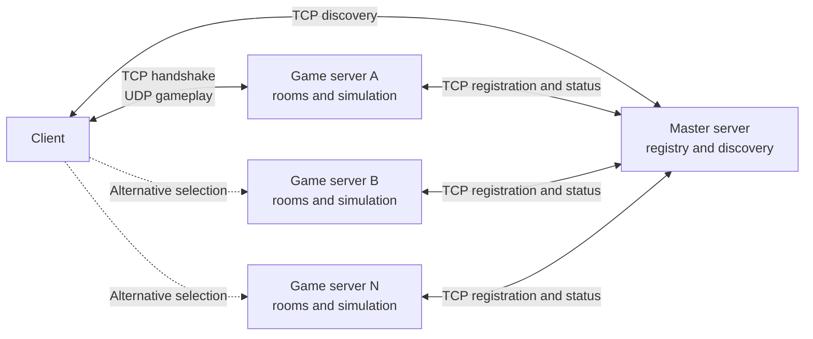
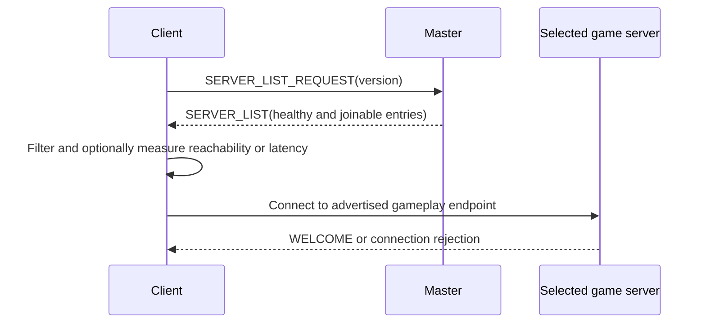
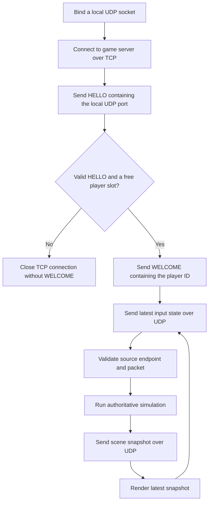
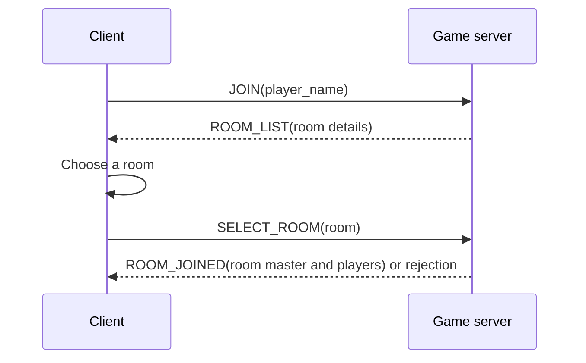
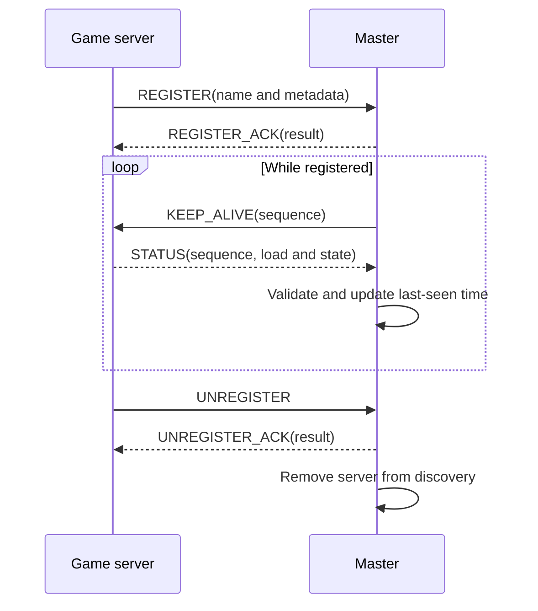

# R-Type network system

## Scope and status

- Gameplay protocol: one client ↔ one game server.
- Control protocol (planned): master server for discovery and monitoring.
- Gameplay wire format: [`protocol.md`](protocol.md). Simulation and responsibilities: [`architecture.md`](architecture.md).
- This doc supersedes `protocol.md`; `protocol.md` stays authoritative for implemented packets until changes land here.
- Master, registry, discovery, registration, health checks: planned, not implemented. Control-plane layouts here are the target.
- Keywords: **must**, **must not**, **should**, **should not**, **may** = required, forbidden, recommended, not-recommended, optional.

## Goals

Several independent game servers behind one well-known **master server**:

1. Master listens for registrations and discovery requests.
2. Game server connects and registers its public gameplay endpoint and capacity.
3. Master validates and adds/updates the registry entry.
4. Master periodically checks the server and updates room/player/availability info.
5. Client requests a server snapshot.
6. Client may measure latency/reachability.
7. Player selects a server; client connects directly.
8. Selected server handles all gameplay; never relayed through the master.

Server list = snapshot, not reservation. A listed server can fill, drain, or vanish before connect. Client must handle rejection/failure and return to discovery.

## Terminology

| Term | Meaning |
| --- | --- |
| Master server | Control-plane service: registers servers, monitors health, answers discovery. |
| Game server | Owns rooms, players, gameplay networking; final authority on simulation state. |
| Control plane | Reliable TCP to the master. |
| Data plane | Direct TCP/UDP between client and its game server. |
| Advertised endpoint | Public address/port peers use; may differ from the bind address. |
| Healthy | Valid status response within the health timeout. |
| Joinable | Healthy, compatible, `READY`, and has capacity. |
| Room | One session on one server; max four players. Planned. |
| Room master | First player to create/join a room; owns room-level decisions. Server stays final authority. |

## Architecture



- Master = control plane: discovery and health only, no simulation.
- Selected server = data plane: owns the full session.
- Master not in the gameplay path: losing it must not interrupt a session; only blocks new discovery.

## Transport overview

| Connection | Transport | Lifetime | Purpose |
| --- | --- | --- | --- |
| Game server to master | TCP | Persistent while registered | Registration, health checks, status, unregistration |
| Client to master | TCP | May close after the response | Server discovery |
| Client to game server | TCP | Persistent for the player connection | Gameplay handshake and liveness |
| Client to game server | UDP | Session lifetime | Player input and authoritative state or corrections |

- Master endpoint: deployment-configured, known to servers and clients; no reserved master port.
- Current server defaults: TCP `7000`, UDP `7001`; registered servers may advertise other ports.
- Advertised endpoint must be reachable by peers. Binding `0.0.0.0`, `::`, or a private address is not a usable public endpoint. NAT/port-forward/DNS/firewall = deployment. No NAT traversal here.

## Responsibilities

### Master server

Registry and discovery authority. Must:

- accept and validate registrations;
- key servers by unique name;
- store advertised address, ports, capacity, version, state;
- track rooms, joinable rooms, connected players;
- check liveness;
- return only healthy, compatible, joinable servers;
- drop stale registrations after retention.

Must not:

- simulate gameplay;
- own rooms, entities, input, or player state;
- forward handshakes, input, or snapshots;
- treat discovery as a reservation;
- move a player between servers.

Health vs publication: first failed check → may keep the server, mark suspect. Health timeout → must mark unhealthy, exclude from discovery; may drop the entry later.

Registry is in-memory. After a master restart, servers must re-register. No persistence needed: a stored entry is not proof of health.

### Game server

- persistent control connection to the master;
- registers advertised address, ports, version, capacity;
- answers health checks with a status snapshot;
- reconnects and re-registers on connection loss;
- accepts clients directly;
- owns rooms, player slots, connections;
- runs the lobby exchange, admits players to rooms;
- caps rooms at four players, assigns the room master;
- final authority on simulation state;
- sends authoritative state/corrections directly.

Must enforce capacity at handshake even if the master advertised free capacity. Master never grants a slot.

Should unregister on orderly shutdown. If the master is unreachable, may still stop; health timeout removes it.

### Client

Two flows.

#### Discovery flow



- Must use the gameplay address/ports from the selected entry, not the master's.
- Latency = hint only; not a reservation, not a guarantee.
- No ping packet. TCP connect time is a coarse reachability measure; avoid repeated gameplay connections just to rank. Future ping command may add a side-effect-free measure.

#### Gameplay flow

Implemented flow:



- Handshake/UDP layouts: [`protocol.md`](protocol.md). Client binds UDP before the TCP handshake; server identifies UDP input by TCP peer address + `HELLO` UDP port.
- Client owns input, rendering, presentation. Server is final authority for movement, collisions, entities, room state.
- Current: server simulates, client renders snapshots. Planned: client simulates locally, reconciles with periodic corrections.
- Client prediction/interpolation must be corrected by authoritative server state.

#### Room selection flow (planned)

Lobby exchange after the handshake, before gameplay. Not implemented.



- Client sends `player_name` (8 ASCII bytes, same encoding/validation as `server_name`).
- Server returns rooms with details: name, player count, max players, state.
- Client selects; server admits or rejects (full/closed).
- Room master = first player to create/join. Owns room-level decisions; server stays final authority.
- Max four players per room (matches player IDs `0`–`3`).
- Message layouts, command values, room-detail fields: design targets.

#### Planned simulation model

Target: move the simulation step to the client.

- Client runs the game loop locally at the server's fixed rate (currently 60 Hz).
- Client sends input; server stays final authority.
- Server sends corrections, not full snapshots, at a lower rate (order of 30 Hz).
- Client reconciles each correction, re-simulating from the corrected state (rollback).
- Traffic minimal: send only changed/needed state, not a full scene per tick.

Not implemented. Correction rate, reconciliation algorithm, and correction wire format are design targets. Current protocol has no sequence numbers/acks → corrections need new wire format.

No explicit rejection packet: before `WELCOME`, rejection = close the TCP connection. Future version may add a reason.

## Game-server states

| Value | Name | Published for new players | Meaning |
| ---: | --- | --- | --- |
| `0` | `STARTING` | No | Initializing, not ready for gameplay. |
| `1` | `READY` | Yes, if healthy and not full | Able to accept new players and rooms. |
| `2` | `DRAINING` | No | Existing sessions may finish; no new players or rooms. |
| `3` | `STOPPING` | No | Shutting down; gameplay connections may close shortly. |

- Unknown values = unavailable.
- Health is master-side, not a server state.
- Full: `connected_players >= max_players`.
- `joinable_rooms` = rooms that can take another player; a room is joinable while it has < 4 players.
- `READY` + spare global capacity may be joinable with `joinable_rooms == 0` if it can create a room.
- Room creation should eventually be advertised; until then, `READY` + global capacity ⇒ can create a room.

## Server lifecycle



- Registration active only after `REGISTER_ACK`. Before that, clients cannot discover it.
- Health-check interval, response deadline, unhealthy timeout, stale retention: deployment config. Must satisfy:
  - response deadline ≤ health-check interval;
  - unhealthy timeout allows ≥ 1 missed response;
  - `STATUS` refreshes `last_seen` only when its sequence matches the outstanding `KEEP_ALIVE` on the same connection.
- One outstanding health check per server. Missing/late/duplicate/malformed/mismatched responses must not refresh `last_seen`.
- Health-check timeout → master closes the control connection (prevents a late response matching a later probe after the sequence wraps).
- TCP connection loss → master must immediately exclude the registration. Server should reconnect with bounded exponential backoff + jitter, then re-register.
- Server name = registry key, unique. Re-register on the same connection with the same name updates the entry. No renaming an active registration; unregister and register again.
- Occupied name from another live connection → reject with `CONFLICT`. If the previous connection closed, a new connection may claim the name and replace the stale entry. A name is not an authentication credential.

## Control-plane wire protocol

### Relationship to the gameplay protocol

- Reliable TCP; command values reserved for master communication.
- No UDP terminator, no nine-byte gameplay command header.
- Multi-byte integers and floats: **big-endian** (network byte order), like IP/TCP/UDP.
- Serialize fields explicitly; never send the in-memory C/C++ struct.

### Design rules

1. **Small frames.** Narrowest fixed-width types; no field the connection already implies.
2. **Cheap decoding.** Only fixed-width scalars and length-prefixed strings; no search, delimiter scan, or backtracking.
3. **Clean memory.** Fixed-width fields first, variable-length last; maps onto a packed struct with no padding or reordering.

### TCP framing

Six-byte header:

| Offset | Size | Field |
| ---: | ---: | --- |
| `0` | 3 bytes | Magic bytes `H`, `A`, `J` |
| `3` | 1 byte | Control command type |
| `4` | 2 bytes | Payload length as an unsigned 16-bit integer |
| `6` | Variable | Command payload |

- Payload length excludes the header → max 65,535 bytes. No terminator.
- TCP is a byte stream: a read may hold part of a frame or several. Buffer, parse the header only when six bytes are available, validate the length, wait for the full payload.
- Reject lengths above the configured max frame size before allocating.
- Bad magic, impossible length, malformed payload → protocol error; close the connection.

### Primitive field encodings

| Type | Encoding |
| --- | --- |
| `u8`, `u16` | Unsigned integer of the stated width; `u16` is big-endian. |
| `server_name` | Exactly 8 ASCII bytes, unused trailing bytes zero. |
| `short_string` | `u8` byte length followed by that many UTF-8 bytes. |
| `version` | Two `u8` values: major, then minor. |
| `server_state` | One `u8` value from the game-server state table. |

- `short_string` length counts bytes, not characters. Reject invalid UTF-8, embedded NUL, length > 255.
- Addresses: DNS name, IPv4 literal, or IPv6 literal. IPv6 literals omit brackets (port stored separately).
- `server_name`: 1–8 printable ASCII. Shorter names pad with `00`. Reject embedded zero-then-non-zero and all-zero names. Compared by full 8-byte form, case-sensitive. Reject > 8 bytes, never truncate. No length byte; copies into an 8-byte registry key.
- Receiver must consume exactly the declared payload. Missing bytes, undefined trailing bytes, invalid enums, arithmetic overflow → malformed.

### Memory layout

- Fixed-width fields ordered for a packed struct with no padding: `u16` before `u8`; fixed portion is a whole number of bytes, no alignment gaps.
- Read the fixed portion into a packed struct, then decode trailing `short_string` fields.
- Use packed structs or explicit serialization. Don't assume the compiler's struct layout matches the wire; don't rely on host endianness.
- Big-endian host: copy the fixed portion verbatim. Otherwise: byte-swap each multi-byte field.
- Variable-length fields always last. No variable-length fields → fully fixed-size.

### Command registry

| Value | Name | Direction |
| ---: | --- | --- |
| `11` | `REGISTER` | Game server to master |
| `12` | `KEEP_ALIVE` | Master to game server |
| `13` | `STATUS` | Game server to master |
| `14` | `REGISTER_ACK` | Master to game server |
| `15` | `UNREGISTER` | Game server to master |
| `16` | `UNREGISTER_ACK` | Master to game server |
| `20` | `SERVER_LIST_REQUEST` | Client to master |
| `21` | `SERVER_LIST` | Master to client |
| `22` | `ERROR` | Either direction, when a response can be sent safely |

Unknown commands must not be interpreted as another type; before version negotiation, receiving one is a protocol error.

### `REGISTER` (`11`)

Sent after opening the master connection and whenever a new registration is needed. Endpoint/capacity changes on an active connection: send `REGISTER` again.

```text
server_name  name
u16          gameplay_tcp_port
u16          gameplay_udp_port
u16          max_players
u8           protocol_major
u8           protocol_minor
short_string advertised_address
```

- Fixed portion: 8-byte name, two ports, `max_players`, two version bytes. Address is the only variable-length field, last.
- Name, both ports, `max_players`: non-zero/non-empty.
- Name must not belong to another live registration.
- Address must not be a wildcard or otherwise unusable.
- Master may apply deployment policy (names, capacities, address families, source networks).
- Don't blindly replace the advertised address with the TCP peer address (NAT, reverse proxies). Accepting an arbitrary address can publish an unreachable/third-party host. Production: validate administratively or with a reachability check.

### `REGISTER_ACK` (`14`)

```text
u8            result
short_string  message
```

| Value | Name | Meaning |
| ---: | --- | --- |
| `0` | `ACCEPTED` | Registration under the requested name is active. |
| `1` | `INVALID` | One or more fields failed validation. |
| `2` | `INCOMPATIBLE` | The gameplay protocol version is unsupported. |
| `3` | `CONFLICT` | Another live connection already owns the name. |
| `4` | `UNAVAILABLE` | The master cannot accept the registration now. |

- `message`: diagnostic text; never parsed for control flow.
- Master should close the connection after a rejected initial registration.

### `KEEP_ALIVE` (`12`)

```text
u8  sequence
```

- Liveness probe + request for fresh status. Server returns one `STATUS` with the same sequence.
- Master increments per probe; may wrap.
- TCP keep-alive complements, does not replace, this.

### `STATUS` (`13`)

```text
u16          rooms
u16          connected_players
u16          max_players
u16          joinable_rooms
u8           sequence
server_state state
```

- Applies to the current registered connection's name; does not repeat it.
- Fixed-size: eight bytes of `u16` counts, then sequence and state.
- Master must validate:
  - sequence matches the outstanding probe;
  - `connected_players <= max_players`;
  - `joinable_rooms <= rooms`;
  - state is known;
  - immutable/policy values (e.g. max capacity) match the accepted registration.
- Instantaneous snapshot; no reservation from counts. Capacity change → update the registration before reporting.

### `UNREGISTER` (`15`) and `UNREGISTER_ACK` (`16`)

- `UNREGISTER`: empty payload; applies to the current connection's registration; no name.
- `UNREGISTER_ACK`:

```text
u8            result       0 for success, non-zero for failure
short_string  message
```

- After a valid unregistration: remove from discovery, close the control connection.
- Server should wait briefly for the ack on orderly shutdown; must not delay shutdown indefinitely.

### `SERVER_LIST_REQUEST` (`20`)

```text
u8  protocol_major
u8  protocol_minor
```

- Region/game-mode filters omitted until the room system has metadata; request stays two bytes.
- Compatibility: primarily the major version. Don't return a server that can't understand the client's gameplay wire format. Define minor-version policy when a minor version adds optional features.

### `SERVER_LIST` (`21`)

```text
u16  entry_count
repeated entry_count times:
  server_name  name
  u16          gameplay_tcp_port
  u16          gameplay_udp_port
  u16          connected_players
  u16          max_players
  u16          rooms
  u16          joinable_rooms
  u8           protocol_major
  u8           protocol_minor
  server_state state
  short_string advertised_address
```

- Each entry: fixed fields, then the variable-length address (the only one).
- Master must bound `entry_count` and the total frame size.
- Normal responses: only healthy, compatible, `READY` servers below global capacity at build time.
- Ordering not significant; may sort by region, load, or documented policy.
- Empty result valid (`entry_count == 0`). Client shows "no compatible servers" and retries with backoff; not malformed.
- Every entry carries the direct gameplay endpoint. Never substitute the master's address/port.

### `ERROR` (`22`)

```text
u8            error_code
short_string  message
```

- For requests that framed safely but couldn't be processed (e.g. unsupported command sequence).
- Diagnostic text must not drive program logic.
- Framing errors: close the connection without a response (frame boundaries may be untrustworthy).
- Error-code registry: left for implementation; define before `ERROR` is machine-readable.

## Gameplay protocol summary

After discovery: connect to a server; the planned network then runs the lobby exchange before gameplay. Gameplay (implemented):

1. Client binds an ephemeral local UDP port.
2. Client opens TCP to the server's advertised gameplay TCP port.
3. Sends the seven-byte `HELLO` with its local UDP port.
4. Server validates message + capacity, assigns player ID `0`–`3`, sends the five-byte `WELCOME`.
5. Client sends 16-byte input datagrams to the advertised gameplay UDP port.
6. Server advances its authoritative simulation at 60 Hz, sends scene snapshots to the registered client UDP endpoint.
7. TCP close/loss → remove the player, clear its input state.

Steps 5–6 are current; planned: client simulates locally at the same rate (currently 60 Hz), server sends corrections at a lower rate (order of 30 Hz) instead of full snapshots.

Current player ID range limits a session to four players. A server advertising more than four total players needs room-aware IDs or one four-player simulation per room.

## Failure handling

| Failure | Behavior |
| --- | --- |
| Invalid registration | Failed `REGISTER_ACK`; do not publish; normally close the connection. |
| Duplicate server name | Keep the live registration; reject the new connection with `CONFLICT`. |
| Missed or invalid status | Do not refresh `last_seen`; exclude the server when its health timeout expires. |
| Control connection closes | Immediately exclude the registration; retain or remove the stale record per registry policy. |
| Server is `DRAINING` | Let existing sessions finish; reject new players; exclude from discovery. |
| Selected server is full or rejects the handshake | Close the attempt, refresh discovery, allow another selection. |
| Gameplay TCP connection closes | Remove the player, forget its UDP endpoint, clear its input state. |
| UDP packet lost, duplicated, or malformed | Discard it and use the next valid packet; do not end the session for one bad datagram. |
| Master unavailable | Existing gameplay continues; discovery and registration reconnect with backoff. |
| Master restarts | Registry starts empty; servers reconnect and register again. |
| No compatible servers | Return an empty list; the client retries later with backoff. |
